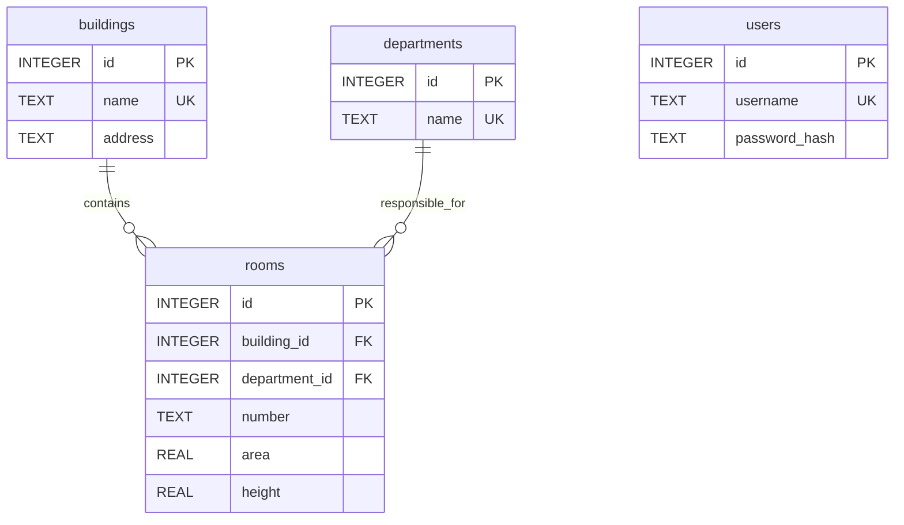

# Схема данных

Схема SQLite: `campus/schema.sql`.
Схема PostgreSQL: `deploy/postgresql/schema.sql`.
Логическая структура одинакова для обеих СУБД; типы на диаграмме соответствуют SQLite.

Все поля обязательны. ID присваивает СУБД. `UNIQUE(building_id, number)`
защищает номер помещения в корпусе. Имена корпусов и подразделений уникальны
внутри соответствующих таблиц. Сравнение регистрозависимое.
Внешние ключи имеют `ON DELETE RESTRICT`; каскадного удаления помещений нет.

`volume` — вычисляемое поле API: `round(area * height, 2)`, не столбец таблицы.
Площадь измеряется в м², высота — в метрах, объём — в м³.
Названия: 1–100 символов; адрес: 1–250; номер: 1–30;
0 < площадь ≤ 100000, 0 < высота ≤ 100.

Настройка файла: `DATABASE_PATH`, по умолчанию `instance/campus.sqlite3`.
Относительный путь отсчитывается от корня проекта, не от текущего каталога shell.
Первый запуск выполняет `CREATE TABLE IF NOT EXISTS`, повторный сохраняет данные.
Схема PostgreSQL создаётся скриптом развёртывания. Прикладная роль `campus_app`
получает права работы с данными, но не создания таблиц. Система миграций отсутствует.

Каждое изменение — отдельная транзакция. При ошибке `db.transaction()` откатывает запись.
Файл БД исключён из Git; тесты используют отдельные временные файлы.

## Учётные записи

Четвёртая таблица `users`: ID, уникальный `username` (1–100 символов),
`password_hash`. Пароль в открытом виде не хранится. Хеш PBKDF2-SHA256 включает
случайную соль и число итераций; сравнение выполняет Werkzeug.
Пользователь создаётся CLI-командой; таблица не доступна через CRUD API.
Связанные предметные сущности по-прежнему — корпуса, подразделения и помещения.

Для существующей SQLite `CREATE TABLE IF NOT EXISTS users` выполняется при
старте без удаления прежних таблиц. Для PostgreSQL администратор должен применить
обновлённый `deploy/postgresql/schema.sql` от имени владельца и выдать права;
порядок обновления приведён в `deploy/README.md`.
