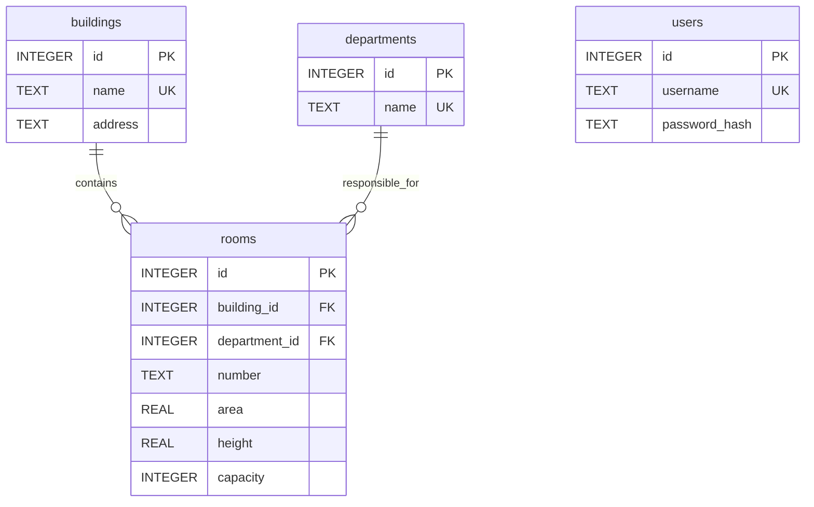

# Схема данных

Исходная схема до миграций SQLite: `campus/schema.sql`.
Исходная схема до миграций PostgreSQL: `deploy/postgresql/schema.sql`.
Логическая структура одинакова для обеих СУБД; типы на диаграмме соответствуют SQLite.

Все поля обязательны. ID присваивает СУБД. `UNIQUE(building_id, number)`
защищает номер помещения в корпусе. Имена корпусов и подразделений уникальны
внутри соответствующих таблиц. Сравнение регистрозависимое.
Внешние ключи имеют `ON DELETE RESTRICT`; каскадного удаления помещений нет.

`volume` — вычисляемое поле API: `round(area * height, 2)`, не столбец таблицы.
Площадь измеряется в м², высота — в метрах, объём — в м³.
Названия: 1–100 символов; адрес: 1–250; номер: 1–30;
0 < площадь ≤ 100000, 0 < высота ≤ 100.

Настройка файла: `DATABASE_PATH`, по умолчанию `instance/campus.sqlite3`.
Относительный путь отсчитывается от корня проекта, не от текущего каталога shell.
Текущее состояние схемы задаёт цепочка Alembic в `migrations/versions`:

1. `001_initial.py` — исходные четыре таблицы; существующие таблицы не удаляются.
2. `002_room_indexes.py` — индексы внешних ключей помещений.
3. `003_room_capacity.py` — `capacity INTEGER NOT NULL DEFAULT 1`, диапазон 1–1000.

`alembic_version` хранит применённую ревизию. `make migrate` применяет отсутствующие
миграции, повторный запуск безопасен. При локальном старте SQLite обновляется
автоматически; на PostgreSQL миграцию выполняет администратор от владельца.
Рабочая роль `campus_app` сохраняет только права на данные.
SQL-файлы — неизменяемые снимки для ревизии 001, новые изменения добавляются
отдельными миграциями. Откат схемы не реализован; возврат выполняется из резервной копии.

Вместимость отражает количество мест. API принимает только целое 1–1000,
без bool, дробей и числовых строк. Старые помещения и запросы без `capacity`
получают значение 1. В интерфейсе поле заполняется явно.

Каждое изменение — отдельная транзакция. При ошибке `db.transaction()` откатывает запись.
Файл БД исключён из Git; тесты используют отдельные временные файлы.

## Учётные записи

Четвёртая таблица `users`: ID, уникальный `username` (1–100 символов),
`password_hash`. Пароль в открытом виде не хранится. Хеш PBKDF2-SHA256 включает
случайную соль и число итераций; сравнение выполняет Werkzeug.
Пользователь создаётся CLI-командой; таблица не доступна через CRUD API.
Связанные предметные сущности по-прежнему — корпуса, подразделения и помещения.

Для существующей БД обновление выполняется через ту же цепочку Alembic;
пользователи и их хеши сохраняются. Порядок описан в `OPERATIONS.md`.
